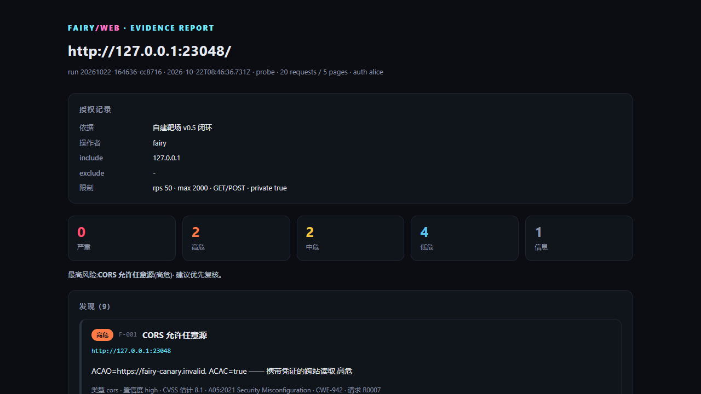

# Fairy / Web

[](LICENSE)
[](package.json)
[](https://github.com/Yilanchia/fairy_web/actions/workflows/test.yml)

**Authorized web-pentest runtime for AI agents.** Fairy gives a model real HTTP
and browser hands while keeping every request inside a declared scope: a scope
passport, per-request audit trail, rate limits, data minimization, and
evidence-first reporting.

- CLI + MCP (stdio): recon, crawling, headless browser (CDP), login/BOLA diff,
  safe injection probes, HAR replay, and sample handoff to Verdex.
- Local-only artifacts: self-contained HTML report, HAR, engagement ledger,
  disclosure draft.
- No runtime dependencies; Node.js >= 20. Chrome/Edge is optional (browser tests
  skip themselves when none is installed).

> **Authorized use only.** Use Fairy on systems you own or have explicit written
> permission to test. See [SECURITY.md](SECURITY.md).

---

> Verdex 够不到的那一段,由这只手来接:**真的发 HTTP,但每一发都带着授权护照和审计。**

Verdex 是证据优先的静态分析内核——源码、逆向、pwn、固件、HAR,全都只读、只产文本、从不联网。这是它的原则,也是它的边界:web 渗透真正需要的那一步,是**和有血有肉的目标交互**。

Fairy / Web 补的就是这一步。它不是一个"更快的扫描器",而是一层**受控的请求层**:

- 没有 `fairy.scope.json` → 一个包都不发。
- 每一次请求 → 过 scope 校验、过限速、写审计、可回查 `request_id`。
- 只证明存在 → 不注入载荷、不爆破、不 dump 数据、不改状态。

三者的组合,才是能让 Fairy 真正"伸手"而不脱手的东西。

```
        ┌──────────────────────────────┐
        │  Fairy(模型)               │
        └──────────┬───────────────────┘
                   │ MCP
     ┌─────────────┴──────────────┐
     │                            │
┌────▼─────────┐          ┌───────▼──────────┐
│ fairy (本仓) │          │ verdex           │
│ 发包 / 取证  │──HAR────▶│ 静态复核 / 源码   │
│ 授权+审计    │          │ 逆向 / pwn / 固件 │
└──────────────┘          └──────────────────┘
```

Fairy 采集到的流量会脱敏导出成 `traffic.har`,直接喂给 Verdex 的 `har_analyze` 做第二遍静态复核——两只手互相校验,而不是各自为战。

---

## 安装

```bash
git clone https://github.com/Yilanchia/fairy_web.git
cd fairy_web
node --version   # >= 20
npm test
```

没有第三方运行时依赖;MCP server 与 CLI 都直接跑在 Node 上。核心功能支持 Node.js 20+;
**浏览器运行时需要 Node.js 22+**(使用内置 WebSocket)与本机 Chrome/Edge(CDP)。
没有浏览器(或 Node < 22)时,浏览器相关测试会自动跳过。

## 快速开始(CLI)

```powershell
node src/cli.js init  D:\work\engagements\lab --include "127.0.0.1" --basis "自建靶场" --operator fairy
node src/cli.js show  D:\work\engagements\lab
node src/cli.js probe D:\work\engagements\lab "http://127.0.0.1:8080/login"
node src/cli.js crawl D:\work\engagements\lab "http://127.0.0.1:8080/" --pages 30 --depth 2
node src/cli.js scan  D:\work\engagements\lab "http://127.0.0.1:8080/" --crawl
node src/cli.js report D:\work\engagements\lab "http://127.0.0.1:8080/" --crawl
node src/cli.js har   D:\work\engagements\lab capture.har
node src/cli.js mcp   --project D:\work\engagements\lab
```

`init` 是唯一会写授权护照的命令;后面所有命令都读它。`report` 会在
`.fairy/runs/<run_id>/` 下落 `report.json` / `report.md` / `report.html` /
`scope.json` / `traffic.har`。

## MCP(让模型直接调用)

挂到 dsh 的 profile 里,模型就会看到 `mcp__fairy__*`:

```powershell
node scripts/mount-dsh.mjs            # 默认 desktop profile,自动备份
# 或者手动在 profile 的 cordis.patch.yml 里加 insert(见 scripts/mount-dsh.mjs)
```

| 工具 | 作用 | 是否发包 |
|---|---|---|
| `fairy_scope_init` | 建授权护照(include/basis/limits) | 否 |
| `fairy_scope_show` | 查看当前 scope | 否 |
| `web_probe` | 单请求取证:状态/头/正文片段/重定向/TLS/`request_id` | 是 |
| `web_crawl` | 同源爬取:标题/链接/表单/JS 端点/外链主机 | 是 |
| `web_scan` | 一轮被动+轻主动检测,按严重度出候选 | 是 |
| `web_report` | `web_scan` + 不可变快照 + 脱敏 HAR | 是 |
| `har_ingest` | 静态分析你导出的 HAR,顺带列主机清单 | 否 |
| `fairy_ledger_init` / `fairy_ledger_show` | 建/看作战账本(资产/事实/发现/意图/覆盖) | 否 |
| `fairy_ledger_add` | 追加资产/事实/发现/意图,自动去重编号 | 否 |
| `fairy_ledger_advance` | 领取/结单意图,改发现状态 | 否 |
| `fairy_ledger_ingest` | 把最近一次扫描报告导入账本 | 否 |
| `fairy_chain_plan` | 按账本匹配攻击链,给最小证明与停止点 | 否 |
| `fairy_planner_tick` | 轮询:落单 ready 链 + 选出下一步/提示审批 | 否 |
| `fairy_chain_materialize` | 把 ready 链落成有依赖的意图序列(幂等) | 否 |
| `fairy_worker_run` | 执行 active 且已审批的意图(probe/compare/browser/param) | 是 |
| `fairy_auto_run` | 自动循环 tick→claim→执行已声明 work,遇审批门停 | 是 |
| `fairy_mission` | 一次有边界的任务:扫描→报告→入账→链规划 | 是 |
| `web_login` | 单次登录并把会话存成命名 profile(不重试/不爆破) | 是 |
| `web_session` | 会话管理:list/show/create/delete,不回显值 | 否 |
| `web_compare` | 双会话差分:BOLA/IDOR/BFLA 证据骨架 | 是 |
| `web_role_matrix` | 多账号 × 多端点权限矩阵(只读 GET) | 是 |
| `fairy_reachability` | 最高授权后的只读身份/权限/资产图 | 是 |
| `web_browser` | 无头浏览器(CDP):渲染/SPA/XHR/截图/页面动作 | 是 |
| `web_replay` | 按 scope 重放 HAR,做状态/长度差分 | 是 |
| `fairy_handoff` | 样本登记 + Verdex 链 + 本机后端预检 | 下载时是 |
| `fairy_ingest` | 统一证据入口:scan/param/WAF/矩阵/可达性/Verdex | 否 |
| `fairy_report_bundle` | 以账本为准生成跨工具证据报告 | 否 |
| `web_param` | 参数级探测:SQLi 错误/布尔、SSTI(需双重授权) | 是 |
| `web_waf` | WAF 指纹 + 编码规范化差异矩阵(需双重授权) | 是 |
| `web_param_adaptive` | 用 WAF 画像驱动 SQLi/SSTI 检测(三重授权) | 是 |
| `web_dom_context` | DOM 反射上下文判定(script/属性/文本) | 是 |
| `fairy_disclose` | 从账本生成披露文档(只取 verified) | 否 |

所有网络工具都要求 `project`(作业目录),scope 与产物都落在那里,天然按 engagement 隔离。

## 作战账本与攻击链

一次 engagement 不只是"扫了一次",而是一条有状态的推进链。账本落在
`.fairy/ledger.json`(不提交、不联网):

```powershell
# CLI 也可以直接看
node -e "import('./src/ledger.js').then(m=>console.log(JSON.stringify(m.summary(m.loadLedger('D:/work/lab')),null,2)))"
```

MCP 里的典型节奏:

```
fairy_ledger_init(project)
web_report(project, urls, crawl=true)
fairy_ledger_ingest(project)            # 资产/技术栈/候选发现入账
fairy_chain_plan(project)               # ready 的链 + 每步证明 + 停止点
fairy_planner_tick(project, materialize=true)  # 落单 + 选下一步
fairy_ledger_advance(action="claim")    # 领取下一步意图
fairy_ledger_advance(action="approve", intent_id="I-002") # requires_approval 的步骤
fairy_worker_run(intent_id="I-001", action="probe", url="https://...")  # 执行并自动结单
# 或者交给自动循环:只执行落单时预先声明的 work,遇审批门/没声明就停
fairy_auto_run(project, work=[{step:1, action:"probe", args:{url:"https://..."}}], max_steps=3)
# 也可以只给 context,让 planner 从链步骤推断只读 work(没有 context 不猜)
fairy_auto_run(project, context={base_url:"https://...", session_a:"bob", session_b:"alice", marker:"..."})
```

攻击链知识库在 [`src/playbooks.js`](src/playbooks.js):CORS+凭证、开放重定向+OAuth、
反射 XSS、Git 源码泄露、BOLA、SSRF、API 文档、SourceMap。每条链都写清楚
**最小证明、风险、是否需要人批准、在哪停**,只产计划不发请求。

战略与 ARTEX 对标见 [`docs/STRATEGY.md`](docs/STRATEGY.md);与大厂/开源/AI 代理的
能力面对比见 [`docs/COMPETITIVE.md`](docs/COMPETITIVE.md)。

## 认证态与 BOLA

登录是写操作,必须先在 scope 里显式授权 POST:

```powershell
node src/cli.js init D:\work\lab --include "127.0.0.1" --basis "自建靶场" --methods GET,POST
node src/cli.js login D:\work\lab http://127.0.0.1:8080/login --session alice --data "username=alice&password=..."
node src/cli.js login D:\work\lab http://127.0.0.1:8080/login --session bob   --data "username=bob&password=..."
node src/cli.js compare D:\work\lab http://127.0.0.1:8080/api/orders/2 --a bob --b alice --marker "BOB-ORDER-2"
```

结果给 `verdict`:`marker-in-both` 且 A 是资源所有者时,说明 B 能读到 A 的对象,
这就是 BOLA 候选。`compare` 默认只回状态/长度/正文哈希/相似度/标记,不回传正文。

安全约束是硬的:

- **只尝试一次**:没有重试、没有字典、没有爆破。
- **会话不裸奔**:设 `FAIRY_SESSION_KEY`(≥8 字符)则 AES-256-GCM;否则 0600 落盘并在返回里带警告。`list`/`show` 只给头名,绝不回显 Cookie/Authorization。
- **登录即写操作**:scope 的 `limits.methods` 不含 POST 时直接拒绝。
- **差分不带数据**:正文只留 sha256 与长度,证据按 `request_id` 回审计日志。

`web_scan` / `web_crawl` / `web_probe` / `web_report` 都接受 `--session`(MCP 里是 `session`),
可以直接对登录后的页面/接口做只读检测。

## 权限矩阵

多账号 × 多端点,只发 GET,只看状态/长度/正文哈希:

```powershell
node src/cli.js matrix D:\work\lab `
  "http://127.0.0.1:8080/account" `
  "http://127.0.0.1:8080/admin" `
  "http://127.0.0.1:8080/api/orders/1" `
  --sessions alice,bob,admin
```

输出:

- `role-restricted`:同一端点有的角色 2xx、有的 401/403 → BFLA 候选;
- `data-diff`:多个账号都 2xx,但正文哈希不同 → IDOR/BOLA 候选;
- `public` / `authenticated` / `blocked` 用于区分公开面与登录面。

它只给候选,不读对象内容、不提权、不执行横向。复核时用两个真实测试账号,
确认差异来自对象归属,不要批量拉数据。

## 最高授权闸:只读触手

跨资产可达性需要一份**签名授权文件**,不是 UI 开关:

```powershell
$env:FAIRY_AUTH_KEY = "至少16字符的密钥"   # 授权人保管
node src/cli.js high-auth D:\work\lab `
  --basis "客户书面授权 + 红队范围附件" `
  --approver "security-lead" `
  --assets "127.0.0.1,10.10.0.0" `
  --hours 24

node src/cli.js reachability D:\work\lab `
  "http://127.0.0.1:8080/account" `
  "http://127.0.0.1:8080/admin" `
  --sessions alice,admin
```

`high-auth` 只能由持有 `FAIRY_AUTH_KEY` 的授权人运行;agent 只能验证、不能自签。
授权文件写清依据、批准人、资产清单、到期时间,并用 HMAC-SHA256 签名。

闸后只开三件事:

- 跨受权资产只读 GET;
- 身份/权限/资产可达性图;
- 角色差异与登录态差异候选。

闸后**不开**:横向执行、凭据窃取、持久化、隧道、隐蔽规避。
`actions` 只允许 `read-only`;签名里出现其他动作直接拒绝。

## 浏览器运行时

零依赖,直接走本机 Chrome/Edge 的 CDP。用来覆盖原始 HTTP 摸不到的部分:SPA 渲染、
JS 动态链接、XHR、DOM、控制台错误、登录后的页面。

```powershell
node src/cli.js browser D:\work\lab http://127.0.0.1:8080/spa
node src/cli.js browser D:\work\lab http://127.0.0.1:8080/account --session alice
node src/cli.js browser D:\work\lab http://127.0.0.1:8080/ \
  --fill "#username=alice" --fill "#password=secret" --click "button[type=submit]"
```

MCP 里是 `web_browser`,支持 `actions`:

| action | 作用 |
|---|---|
| `fill` | 填表单并触发 input/change |
| `click` | 点击元素 |
| `eval` | 在页面里执行一段 JS(返回值不回传) |
| `wait` | 等待毫秒数 |

安全边界:

- **浏览器网络层套 scope**:`Document / XHR / Fetch / WebSocket` 全部逐请求校验,
  越界直接 `BlockedByClient` 并写入审计;渲染子资源(图片/CSS/字体)放行,否则页面根本渲染不出来。
- **登录态注入**:Cookie 走 `Network.setCookie`,Authorization 走额外请求头;值不落输出。
- **不抓正文**:默认只给标题/文本摘要/链接/表单/XHR 元数据;截图落在
  `.fairy/browser/<run_id>/page.png`,不进报告。
- 每跳仍受 `max_requests` 熔断;浏览器动作在页面内执行,不能绕过网络层闸门。

## 参数级与 DOM 判定

这两类检测默认是**关着的**,要两道授权:scope 里 `allow_active_probes: true`,调用时
`confirm: true`。

```powershell
node src/cli.js init D:\work\lab --include "127.0.0.1" --basis "自建靶场" --allow-active-probes true
node src/cli.js param D:\work\lab "http://127.0.0.1:8080/item?id=1" --confirm --classes sqli,ssti
node src/cli.js dom   D:\work\lab "http://127.0.0.1:8080/search?q=x" --param q
```

- **SQLi**:单引号错误签名、`' AND '1'='1` / `'2` 布尔差分。只判存在,不 UNION、不堆叠、不时间盲注、不取数据。
- **SSTI**:`{{7*7}}` 是否被求值为 `49`;表达式原样回显不算。
- **DOM 上下文**:构造 `fairy<hex>` 标记,用浏览器看它落在 `<script>`、事件属性、普通属性、文本还是注释,顺带读 CSP。只判定,不生成载荷。
- 每类证到即停;发现带 `request_id`,布尔差分注明可能被动态页面干扰。

## WAF 行为分析

这是**测量**,不是一键绕过。

```powershell
node src/cli.js init D:\work\lab --include "127.0.0.1" --basis "自建靶场" --allow-waf-probe true
node src/cli.js waf D:\work\lab "http://127.0.0.1:8080/item?id=1" --param id --confirm
```

它做三件事:

1. 从响应头 / Cookie / 拦截页识别常见 WAF(Cloudflare、Akamai、Imperva、F5、Sucuri、FortiWeb、ModSecurity、阿里云、腾讯云、雷池、安全狗等)。
2. 用带标记的四种语法形状(HTML 标签、单引号、路径穿越、模板表达式)测拦截。
3. 对每种形状做单次 URL 编码、双重编码、HTML 实体、JS Unicode 四组变体,输出"哪些变体到达了后端"的矩阵。

`verdict=normalization-gap` 只说明 WAF 与后端解码不一致,不等于可以绕过。它不会把真实攻击载荷套进变体,也不会自动继续打。要验证,由人在授权范围内完成。

`web_waf` 会把画像写到 `.fairy/waf/profile.json`。需要把通过项用于检测时:

```powershell
node src/cli.js param-adaptive D:\work\lab "http://127.0.0.1:8080/item?id=1" --param id --confirm
```

`web_param_adaptive` 读取画像里的推荐变体,只把它们套到 SQLi/SSTI 的**存在性探针**上,
例如双重编码的单引号、布尔表达式、`{{7*7}}`。它不会套真实攻击载荷,也不取数据。

双重授权:scope 里 `allow_waf_probe: true`,调用时 `confirm: true`。自适应探测还要求
`allow_active_probes: true`。少一个都拒绝。

## Mission 与基准

一次有边界的任务,不是“全自动打穿”:

```powershell
node src/cli.js mission D:\work\lab "http://127.0.0.1:8080/" --crawl
```

它按顺序做:扫描 → 写报告 → 入账 → 链规划,返回 `next`(可执行的下一步)。
默认**不登录、不跑参数探测、不跑 WAF 画像**;这些主动步骤仍然要单独授权。

本地基准:

```powershell
npm run bench
```

只打本机靶场,输出 `bench/results/latest.json` / `.md`:类别召回率、非预期类别、
请求数、单条发现成本。当前的基线是 100% / 100% / 3.5 请求一条;这只能说明
“已知类别没退化”,不是对外产品评测。

## 证据闭环

所有工具的结果都走同一个入口,而不是各自为战:

```powershell
node src/cli.js ingest D:\work\lab D:\work\lab\param.json
node src/cli.js ingest D:\work\lab D:\samples\verdex-report.json --source verdex
node src/cli.js bundle D:\work\lab
```

`fairy_ingest` 负责:

- 按 `schema` 识别 scan / param / WAF / 权限矩阵 / 可达性 / Verdex;
- 归一成账本 asset / fact / finding;
- 写 `source_run_id` / `source_id`,重复导入幂等;
- WAF 只入账为事实,不硬造漏洞;
- 每条 finding 先归到 `candidate`,再等人工转 `verified`。

`fairy_report_bundle` 以账本为准,输出 `.fairy/reports/<时间>/report.{json,md,html}`,
包含所有来源的发现、资产、事实、覆盖 runs。这样“每一发都能解释”才真正兑现。

## 报告与交付

每条发现都带:**OWASP 分类、CWE、CVSS 估计、修复建议、复现步骤、`request_id`**。
`report.html` 是自包含的,可以直接发给同事;`report.md` 进工单;`traffic.har`
脱敏后交给 Verdex 做第二遍静态复核。

HAR 重放用来回答"当时是这样,现在还是吗":

```powershell
node src/cli.js replay D:\work\lab capture.har --max 50
node src/cli.js replay D:\work\lab capture.har --allow-write --session alice --replace "OLD_ID=NEW_ID"
```

- 默认只放 `GET/HEAD`;写方法要 scope 授权 + `--allow-write`。
- 不沿用 HAR 里的 Cookie/Authorization,认证态用 `--session` 现取。
- 只回状态/长度/哈希,不回正文;越界请求直接跳过并计数。

> CVSS 是估计值,用于排序与沟通;定级前需要人工校准。**候选不等于已验证。**



## Fairy ↔ Verdex 交接

Fairy 不啃二进制。web 上捞到 APK/固件/ELF/PE,它负责**登记 + 分诊 + 把链交出去**,
真正分析由智能体调 Verdex 完成:

```powershell
# 本地样本:直接登记,给出 Verdex 链
node src/cli.js handoff D:\work\lab D:\samples\app.apk

# web 样本:必须显式确认才下载(单文件 ≤20MB,落 .fairy/artifacts,算 sha256)
node src/cli.js handoff D:\work\lab https://target.example/downloads/app.apk --confirm
```

返回里除了 `artifact`(路径/类型/sha256)和 `verdex.chain`,还有 **`preflight`**:
逐条告诉你本机缺哪个后端(`file`/`objdump`/`jadx`/IDA/Ghidra…),以及 `warnings`。
智能体随后调 `mcp__verdex__analyze_target`,按可用后端跳步执行——不会一头撞死在
`bin_info: 后端未安装 file` 上。

样本本身**永远不执行**;落盘后只做静态分析。`binary-artifact` 链会把它并入作战账本,
下一步该做什么(解包、反编译、扫密钥)直接进 `fairy_chain_plan`。

Verdex 分析完成后,把它的 `report.json` / `analysis.json` 传回 Fairy:

```powershell
node src/cli.js ingest D:\work\lab D:\samples\verdex-report.json --source verdex
node src/cli.js bundle D:\work\lab
```

`fairy_ingest` 会把 Verdex 的 `file:line` 发现归一成账本 finding(来源 `verdex`),
再去重、补 OWASP/CWE/CVSS 估计,最后进跨工具报告。样本分析不回流,证据回流。

## 授权护照

```json
{
  "schema": "FairyScope/v1",
  "authorization": {
    "basis": "自建靶场 / 某 SRC 项目 #123 / 书面授权",
    "operator": "fairy",
    "expires_at": "2026-12-31T23:59:59+08:00"
  },
  "include": ["127.0.0.1", "*.lab.example.com", "10.10.0.0/24"],
  "exclude": ["pay.lab.example.com"],
  "limits": {
    "rps": 5,
    "max_requests": 2000,
    "max_pages": 40,
    "max_active_pages": 15,
    "timeout_ms": 10000,
    "allow_private": true,
    "allow_active_probes": false,
    "allow_waf_probe": false,
    "verify_tls": true,
    "methods": ["GET", "HEAD", "OPTIONS"]
  }
}
```

规则是硬的:

- `basis` 少于 8 字 → 拒绝。写清楚"凭什么"。
- `*`、`*.com` 这类过宽声明 → 拒绝。
- `exclude` 永远压过 `include`。
- 目标解析到 `169.254.169.254` / `100.100.100.200` 等云元数据地址 → 无条件拒绝。
- 解析到内网地址但 `allow_private` 未开 → 拒绝(自建靶场请显式打开)。
- `expires_at` 过期 → 拒绝启动。
- 重定向每一跳都重新过 scope;跳出授权范围就停在原地,把跳转记录成证据。
- 默认只读方法;要 POST/PUT 必须在 `methods` 里显式加。

## 检测项

| 类型 | 说明 | 默认严重度 |
|---|---|---|
| `security-header` | CSP / XFO / XCTO / HSTS / Referrer-Policy 缺失 | low |
| `cookie` | Set-Cookie 缺 HttpOnly / Secure / SameSite | medium/low |
| `cors` | ACAO 反射任意 Origin,或 `*` + credentials | high/medium |
| `reflection` | 参数值原样反射进 HTML(仅标记,不是载荷) | medium(low confidence) |
| `open-redirect` | 常见跳转参数被外部 canary 控制 | medium |
| `exposure` | `.git/HEAD`、`.env`、Actuator、`server-status`、`.DS_Store` 等 | high/medium/info |
| `directory-listing` | `Index of /` | medium |
| `tls` | 过期/将过期/旧协议 | high/medium |
| `info-disclosure` | Server / X-Powered-By 版本泄露 | info |

所有结果都是**待复核候选**,带证据片段和 `request_id`;`request_id` 可以在
`.fairy/audit/<run_id>.jsonl` 里翻到对应请求。Fairy 不会把"静态推断"写成"已验证"。

## 安全边界(写死在代码里,不是口号)

明确不做:**横向执行、凭据窃取、持久化、隧道、隐蔽规避、数据 dump**。
权限矩阵只做“谁能到哪”的只读可见性;不提供拿下一台再打下一台的链路。

- **不发载荷**:反射检测只放 `fairy<hex>` 这种无特殊字符标记,由人判断上下文。
- **不爆破**:没有字典、没有并发轰炸;`rps` 与 `max_requests` 双重上限,超了直接停。
- **不 dump**:发现敏感数据只截 240 字证据,不批量拉取、不横向。
- **不改状态**:默认 GET/HEAD/OPTIONS;POST 等需 scope 显式授权。
- **不越界**:DNS 归属检查 + 逐跳重定向校验 + 元数据地址黑名单。
- **不裸奔**:Cookie/Authorization/Set-Cookie 在报告与 HAR 里一律脱敏;URL 里的
  token/secret/session 类参数打码。
- **可回滚**:每次 `web_report` 都把当次 `scope.json` 快照进 run 目录,授权记录与
  证据绑在一起。

## 和 Verdex 的桥

```powershell
node scripts/verdex-bridge.mjs "D:\...\.fairy\runs\<run_id>\traffic.har"
```

它调用 Verdex 的 `analyzeHar`,对 Fairy 采集的流量做第二遍静态判断(缺失头、
Cookie 标志、CORS、URL 令牌、反射)。同样的 HAR 也可以直接丢给
`mcp__verdex__har_analyze`。

分工建议:**Fairy 负责"外面长什么样",Verdex 负责"里面是什么逻辑"**。
拿到 JS/源码后用 `scan` / `js_deobfuscate` / `secrets`,拿到二进制后走 `bin_*` 链。

## 测试

```powershell
npm test
```

内置一个只监听 `127.0.0.1` 的靶场(`tests/fixture-server.mjs`),覆盖:

- scope 过宽/缺依据/过期拒绝
- 云元数据与未放行内网地址拒绝
- 靶场扫描命中 CORS/Git 暴露/开放重定向/反射/Cookie/安全头
- `max_requests` 熔断
- HAR 导入、报告落盘、HAR 脱敏
- MCP `initialize` / `tools/list` / `scope_init` / `web_scan` 端到端

## 目录

```
src/
  scope.js       授权护照:解析、校验、主机匹配、私网/元数据判定
  http.js        低层 HTTP(手动重定向、CookieJar、TLS 信息、解压)
  guard.js       唯一出口:校验 → 限速 → 审计 → 采集
  crawl.js       同源爬取 + HTML 解析
  fingerprint.js 技术栈指纹
  checks.js      被动/主动检测与暴露面
  scan.js        编排、去重、统计
  har.js         HAR 导入 / 脱敏导出
  auth.js        单次登录 + 双会话差分
  browser.js     CDP 无头浏览器(SPA/XHR/截图/动作)
  replay.js      HAR 按 scope 重放与差分
  taxonomy.js    OWASP/CWE/CVSS/修复/复现归类
  artifacts.js   样本类型识别 + Verdex 链/后端预检
  handoff.js     样本登记、下载、交接给 Verdex
  probe.js       参数级探测(SQLi/SSTI,只判存在)
  waf.js         WAF 指纹 + 编码规范化差异矩阵
  domxss.js      DOM 反射上下文判定
  disclosure.js  披露文档生成
  session.js     会话保管(加密/0600/不回显)
  ledger.js      作战账本:资产/事实/发现/意图/覆盖
  planner.js     把 ready 链落成有依赖的意图序列
  worker.js      执行 active 意图(白名单动作 + 审批门)
  auto.js        自动循环:tick→claim→执行已声明/推断的 work
  work.js        从 chain 步骤 + context 推断只读 work
  matrix.js      多账号 × 多端点权限矩阵(只读)
  highauth.js    最高授权文件(HMAC,仅 read-only)
  reachability.js 最高授权后的身份/权限/资产图
  ingest.js      统一证据入口(scan/param/WAF/矩阵/可达性/Verdex)
  evidence-report.js 以账本为准的跨工具报告
  mission.js     有边界的任务:扫描→报告→入账→链规划
  playbooks.js   web 攻击链知识库与匹配
  report.js      JSON / Markdown / 自包含 HTML
  mcp.js         MCP(stdio)
  cli.js         CLI
docs/            战略与对标
tests/           靶场 + 测试
bench/           本地类别级基准
scripts/         demo 靶场、Verdex 桥、dsh 挂载
```

## 路线图

- [x] v0.2 作战账本(资产/事实/发现/意图/覆盖)+ 8 条攻击链知识库
- [x] v0.3 认证态:单次登录 + 加密会话 + 双账号 BOLA 证据差分
- [ ] v0.3 角色/权限矩阵:普通用户 vs 管理员端点
- [x] v0.4 浏览器运行时(CDP 零依赖):SPA/XHR/DOM/控制台/截图/页面动作
- [x] v0.4 HAR 重放:按 scope 重放并做状态/长度差分
- [x] v0.5 报告 v2:OWASP/CWE/CVSS 估计/复现步骤/修复建议
- [x] v0.5 参数级差分:SQLi(错误/布尔)、SSTI,只判存在
- [x] v0.5 DOM 上下文判定:script/属性/文本/注释 + CSP
- [x] v0.5 披露文档:只取 verified,不带证据正文
- [ ] v0.5 交互审批门(高风险步骤暂停等确认)
- [x] v0.6 样本交接:artifact 发现/下载/登记 + Verdex 链 + 后端预检
- [x] v0.8 WAF 行为分析:指纹 + 编码规范化差异矩阵(只测量,不自动绕过)
- [x] v0.8 自适应检测:用 WAF 画像的通过变体驱动 SQLi/SSTI 只读探针
- [x] v0.9 mission:扫描→报告→入账→链规划 + 本地类别级基准
- [x] v0.10 planner/worker:链落单 → 依赖领取 → 审批门 → 结单
- [x] v0.11 worker:执行 active 意图(probe/compare/browser/param),结果写回账本
- [x] v0.12 planner tick:自动落单 + 选下一步 + 审批提示
- [x] v0.13 auto loop:执行已声明 work,遇审批门/无声明即停
- [x] v0.14 work 推断:给了 context 才推断,没有就停在 needs_action
- [x] v0.15 权限矩阵:多账号 × 多端点,识别 BFLA/IDOR 候选
- [x] v0.16 最高授权闸:HMAC 授权 + 只读可达性图,不解锁横向执行
- [x] v0.17 证据闭环:统一 ingest + 跨工具报告,Verdex 发现回流账本
- [ ] 角色/权限矩阵:普通用户 vs 管理员端点
- [ ] Fairy 记忆:跨 engagement 记录"这个站踩过什么坑"

## 已知限制

- 单次请求 + 启发式规则,不构成完整攻击面;`max_pages` / `max_active_pages` 之外的路径不会被测。
- 反射/CORS/跳转都是候选,必须在浏览器或双账号环境人工复核后才能定级。
- 无头浏览器覆盖不到 Canvas/复杂 WebAuthn 等场景;这类页面仍需人工。
- 主动检测会向目标发包,仅限授权范围,并遵守项目规则(限速/禁爆破/测试时段)。

---

只对授权目标动手。发现敏感数据即停,不 dump、不横向、不 hack-back。赢,还要全身而退。

## License

MIT © 2026 Yilanchia. See [LICENSE](LICENSE).
